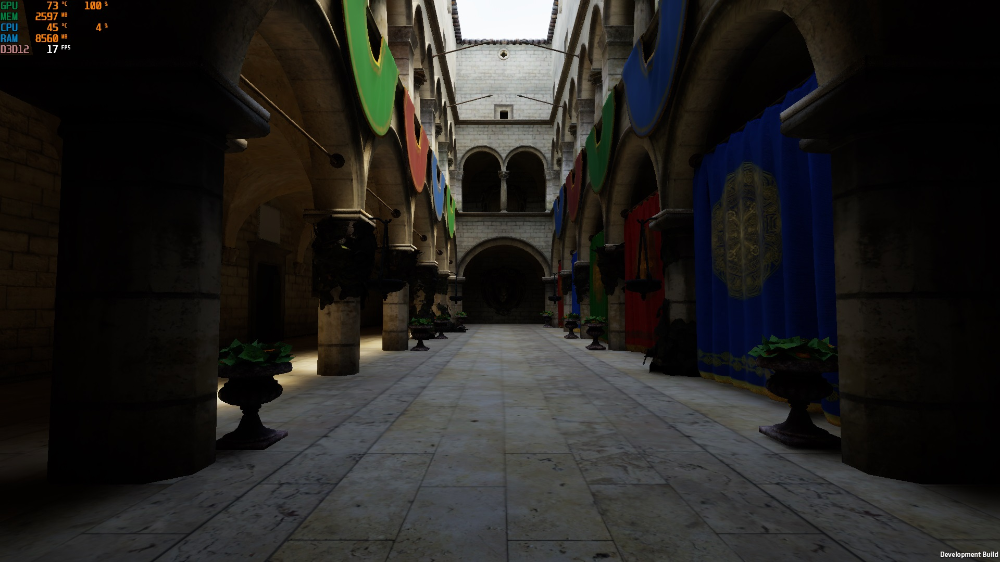

# Unity Real-Time Path Tracing

An experimental GPU path tracer for Unity's Built-in Render Pipeline, focused on dynamic first-person scenes. Uses hardware ray tracing and NVIDIA NRD REBLUR for diffuse and specular denoising.

This is a working rendering prototype. Performance, temporal stability and material compatibility are still being improved; it is not yet a production-ready FPS renderer.

## Features

- Multi-bounce diffuse and specular lighting, directional and point lights.
- Environment lighting from an HDR cubemap, with optional environment NEE and MIS.
- NVIDIA NRD 4.18 REBLUR integration, with motion vectors and temporal reprojection.
- Support for moving objects and skinned meshes.
- Texture-aware denoising, normal maps, metallic/specular workflows and alpha-tested materials.
- Experimental glass and transmission support.
- Exposure control, Reinhard and ACES-fitted tone mapping.
- Adjustable samples per frame, render scale and bounce limits.
- Spatial denoising fallback and diagnostic views.

## Requirements

- Unity **6000.0.68f1** — the version used for development.
- **Windows x64**, **DirectX 12**, and a GPU supporting Unity hardware ray tracing.
- **Built-in Render Pipeline**. URP and HDRP are not supported by this integration.

Development targets the **GeForce RTX 5070 Ti**. Compatibility and performance on other GPUs have not been established.

## Getting started

1. Open the project in Unity and allow assets and shaders to finish importing.
2. Use DirectX 12 as the Windows graphics API and Linear color space. Restart the Editor if changing the graphics API.
3. Open `Assets/Scenes/SampleScene.unity` and enter Play Mode.
4. Move with **WASD**, look with the **mouse**, jump with **Space**, and press **F8** to toggle path tracing.

The tracer can attach automatically to the active perspective camera tagged `MainCamera`. Defaults are stored in `Assets/Resources/PathTracing/Settings.asset`; an existing manually configured component retains its own settings.

| Setting | Default |
| --- | --- |
| Samples per frame | 8 |
| Render scale | 1.0 |
| Denoiser | NRD REBLUR |
| Environment NEE | Off |
| Exposure | +3 EV |
| Environment intensity | 1 |
| Tone mapping | ACES-fitted |

The configured environment is `Assets/Skybox/CloudyNoon.exr`. Use exposure to adjust displayed brightness; environment intensity changes the lighting itself.

## Performance and limitations

The preview capture shows approximately **17 FPS** in a Development Build. This is an example of the current state, not a controlled benchmark or a performance guarantee.

Path tracing cost depends heavily on resolution, samples per frame, scene complexity and path length. Environment NEE is disabled by default because its additional visibility rays can be expensive. Lower samples or render scale when exploring performance.

Temporal denoising can show ghosting or transient noise during fast motion, disocclusion and lighting changes. Material conversion is approximate; arbitrary Unity shaders are not supported. Glass is experimental and does not provide a general caustics solution. ACES-fitted is a tone-mapping approximation, not a complete ACES color pipeline.

## Project layout

- `Assets/Runtime` — rendering, scene tracking and NRD dispatch integration.
- `Assets/Resources/PathTracing` — shaders, compute kernels and default settings.
- `Assets/Plugins/x86_64/NRD.dll` — native NRD dispatch planner; GPU passes run through Unity compute shaders.
- `Assets/ThirdPartyNotices/PortablePathTracing-NRD` — dependency versions, notices and licenses.

## Credits and licensing

Denoising uses [NVIDIA NRD](https://github.com/NVIDIA-RTX/NRD). Third-party components retain their respective licenses; see the included notices.

Sponza model from https://github.com/jimmiebergmann/Sponza

Author: Przemyslaw Zaworski, 2026

